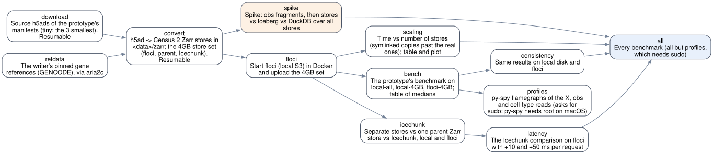

# census2_experiments

A design spike built around [cellxgene-census2-prototype](https://github.com/chanzuckerberg/cellxgene-census2-prototype) (`e54290c`; spike branch `spike/obs-duckdb` @ `8a174de`).
Not intended for production: it explores how Census 2 (one Zarr store per dataset, Parquet catalog) performs against local disk and a local S3 emulator, with more stores, under added latency, and against a parent Zarr store, Icechunk, Iceberg and DuckDB, to guide development ideas.

**This does not substitute the real benchmarks.** It is a baseline for benchmarking data access patterns locally: change a layout, a reader or a query, re-run, and compare on the same data and machine. The authoritative benchmarks will be the ones run against the real data, once Census 2 data is available.

Claude (Anthropic) was used to run the benchmarks and present the results.

## Overview



The pixi tasks and their depends-on (`pixi run dag` redraws it).

103 human datasets of Census 1 LTS `2025-11-08` (147 GiB h5ad, 13.3M cells); manifests from the prototype's `bulk-ingest-nf/manifests/` (`tools/census1-sample.py`).
Of the prototype's Nextflow ingest pipeline only `stage-refdata.py` is used, for the GENCODE gene references the writer needs. `download.py` fetches the h5ads over HTTPS, and `convert.py` calls the same writer (`census2_dataset_writer.create`) locally.

## Layout

`prep/` download, subset, convert · `floci/` local S3 in Docker · `benchmarks/` the benchmark drivers · `spike/` the Iceberg/DuckDB spike · `analysis/` tables, plots, flamegraphs · `config.py` paths per profile · `pixi.toml` the task graph · `docs/` its drawing · `ext/` the prototype and the spike, pinned.

## How to use this repo

1. Run the tiny profile to check the setup.
2. Run the full data once, to have your own baseline in `results/` (the committed one is from the machine below).
3. Change what you want to test, re-run only its task (`pixi run scaling`, `pixi run latency`, ...; `pixi task list` shows them) and diff the tables: `results/bench.md`, `results/scaling/bench.md`, `results/icechunk/bench.md`, `results/spike/bench.md`.
4. A new benchmark is a script in `benchmarks/` plus a task in `pixi.toml` (add it to `all`).

Needs [pixi](https://pixi.sh) and Docker (for floci). Every step is a pixi task; `pixi run all` runs the graph.

```bash
git clone --recurse-submodules <this repo>   # prototype and spike, pinned as submodules
pixi run all tiny                            # smoke test: 3 smallest datasets, everything under tiny/
```

The tiny profile runs every task and backend once (shape `open`, 8 workers, 1 repeat): about 2 min, plus about 1 min the first time for the environments, the download (70 MB) and the floci image.

Full data:

```bash
cp config.example.toml config.toml           # where the data (and h5ads) live
pixi run all                                 # download, convert, every benchmark -> results/
pixi run profiles                            # py-spy flamegraphs; asks for sudo
```

Benchmarks take about 70 min on a MacBook Pro (M3 Pro, 48 GB RAM) with the data on an external USB SSD: bench 34, scaling 14, spike 9, icechunk 6, latency 5 min. Download and convert (147 GiB) come first and took a few hours in earlier runs (not re-timed: the files were already there).

Terms: a *shape* is a benchmark query, as in the prototype's `bench` tool: `single` (one dataset), `cell_type` (one cell type across all stores), `open` (open every store), `corpus_obs` (all `obs`), `corpus_x` (all X). A *set* is `<backend>-<stores>`: `local-all`, `local-4GB`, `floci-4GB`; 4GB is the stores that fit in 4 GiB of Zarr, used for S3, the parent store and Icechunk.

floci binds to 127.0.0.1 only, with update checks off; `pixi run floci-stop` stops it.

## License

Provided as is, without warranty of any kind. BSD-3-Clause, see [LICENSE](LICENSE).
