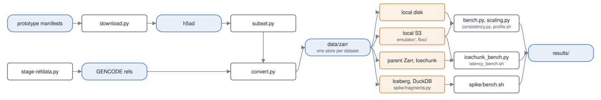

# census2_experiments

A design spike built around [cellxgene-census2-prototype](https://github.com/chanzuckerberg/cellxgene-census2-prototype) (`e54290c`; spike branch `spike/obs-duckdb` @ `8a174de`).
Not intended for production: it explores how Census 2 (one Zarr store per dataset, Parquet catalog) performs against local disk and local S3 emulators, with more stores, under added latency, and against a parent Zarr store, Icechunk, Iceberg and DuckDB, to guide development ideas.

Claude (Anthropic) was used to run the benchmarks and present the results.

## Overview



## Data

103 human datasets of Census 1 LTS `2025-11-08` (147 GiB h5ad, 13.3M cells); manifests from the prototype's `bulk-ingest-nf/manifests/` (`tools/census1-sample.py`).
Of the prototype's Nextflow ingest pipeline only `stage-refdata.py` is used: it fetches the GENCODE gene references that the writer needs. `download.py` fetches the h5ads over HTTPS, and `convert.py` calls the same writer (`census2_dataset_writer.create`) locally, with no Nextflow, Docker or AWS.

```bash
git clone --recurse-submodules <this repo>   # prototype and spike, pinned as submodules
cp config.example.toml config.toml           # set local paths
uv run python download.py                    # to h5ad; --max-gib 50 for a subset. Resumable
uv run python ext/cellxgene-census2-prototype/bulk-ingest-nf/tools/stage-refdata.py data/refdata/   # gene references (GENCODE), needs aria2c
uv run python subset.py <h5ad dir> --max-gib 1000 --out subsets/all.jsonl   # finished h5ads
uv run python convert.py subsets/all.jsonl   # h5ad -> Census 2 Zarr in data/zarr/. Resumable
```

## Benchmarks

```bash
uv run python subset.py data/zarr --max-gib 0.117 --fill --max-store-mib 60 --from subsets/50g.jsonl --out subsets/emu-small.jsonl
emulator/start.sh                                   # AWS Emulator (Docker), uploads emu-small
floci/start.sh                                      # floci (Docker), uploads emu-small + 4g
uv run python bench.py && uv run python table.py    # results/bench.md
uv run python consistency.py local-small emu-small floci-small
uv run python scaling.py && uv run python scaling_plot.py   # time vs number of stores
sudo ./profile.sh && ./render_profiles.sh           # py-spy flamegraphs (SVG)
uv run python parent_zarr.py && floci/upload-parent.sh
uv run python icechunk_bench.py build && uv run python icechunk_bench.py bench
./latency_bench.sh 10 50                            # floci behind latency_proxy.py
uv run --project spike python spike/fragments.py data/zarr && spike/bench.sh   # Iceberg, DuckDB
spike/bench-4g.sh                                   # spike paths on the 4g set, vs Icechunk
```

`-ext` results ran on an external USB SSD with all 103 stores; the others (backend consistency, profiles, spike on 4g) on the internal SSD. Emulators bind to 127.0.0.1 only, telemetry and update checks off. AWS Emulator caps a bucket at 64 MiB, so each store has its own bucket.

## License

Provided as is, without warranty of any kind. BSD-3-Clause, see [LICENSE](LICENSE).
